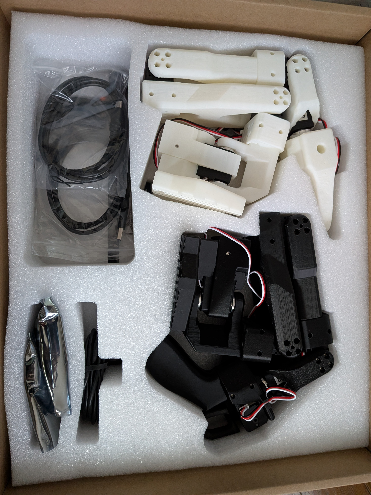
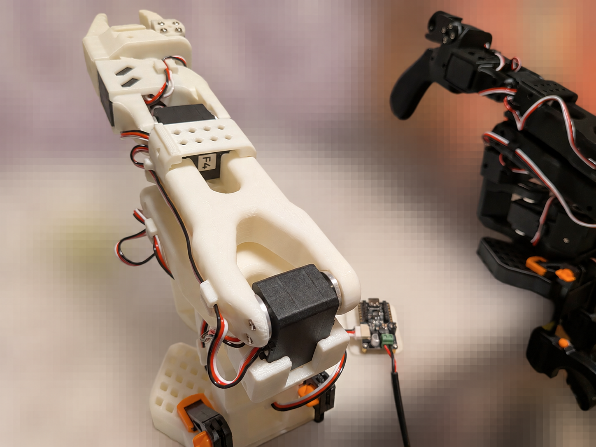

# SO-101 hardware setup　　2026/10/23-11/3

## Placed an order for the SO-101

## The SO-101 arrived
<table>
  <tr>
    <td align="center">
      
       <b> SO-101 </b>
    </td>
  </tr>
</table>

### Hugging Face community
https://huggingface.co/docs/lerobot/so101## Preparing for "Teleoperation"
Set up "teleoperation," where a follower robot tracks the movements of a leader robot.

## 01-1. Prepare the PC
Set up Ubuntu and LeRobot. Verify USB connectivity and serial port permissions.

### A. Install `usbipd-win` to pass the robot's USB connection to Ubuntu
・Run the following command in Windows PowerShell:  
　　　`winget install --interactive --exact dorssel.usbipd-win`  
・Close and reopen PowerShell, then run the following command:  
　　　`usbipd --version`  
・If the version (e.g., 5.3.0-54+Branch.master.Sha.aa...) is displayed, the installation of `usbipd-win` was successful. 

## 01-2. Prepare both arms
Clamp both bases to the table. Check wiring, power supplies, and motor communication. Save the calibration data for each arm.

### A. Leader Setup and Operational Verification
・PC detects the black control board  
・Access permissions successfully configured ⇒ The black control board is now accessible from Ubuntu  
・Ubuntu-side: Prepare the Python environment for LeRobot  
　　　・Install the software required for LeRobot and for communication with the SO-101 motors  
・Mount the leader unit onto the desk  
　　　・Secure the base using a clamp  
・Calibrate the leader unit  
　　　・Verify USB detection and access permissions in Ubuntu  
　　　・Check the communication verification function within the Feetech (servo motor manufacturer) SDK  
　　　・Perform calibration  

### B. Follower Setup and Operational Verification
・Connect the follower’s 3-core cable to the control board  
・Mount the follower unit onto the desk  
　　　・Secure the base using a clamp  
・Calibrate the follower unit  
　　　・Verify USB detection and access permissions in Ubuntu  
　　　・Perform calibration  

<table>
  <tr>
    <td align="center">
      
       <b> follower and leader </b>
    </td>
  </tr>
</table>

### 4. Teleoperation Verification
・Connect the control board of the black "leader" unit to the PC via USB  
・Connect the control board of the white "follower" unit to the PC via USB  
・Initial teleoperation verification:  
　　　・Verification of tracking for [opening/closing of claws (fingers)]: Completed  
　　　・Verification of tracking for [wrist flexion/extension]: Completed  
　　　・Verification of tracking for [wrist rotation]: Completed  
　　　・Verification of tracking for [elbow flexion/extension]: Completed  
　　　・Verification of tracking for [shoulder elevation/depression]: Completed  
　　　　　　　Shoulder tracking issue: Resolved (Cause: Error in follower calibration)  
　　　・Verification of tracking for [shoulder lateral rotation]: Completed  

## Camera Connection and Video Verification

### 1. Setting Up the Capture Environment for Windows
・Prepare Python for Windows / Set up the capture environment / Display live video on Windows / Verify video transmission to Ubuntu  

### 2. Determining the Capture Position
