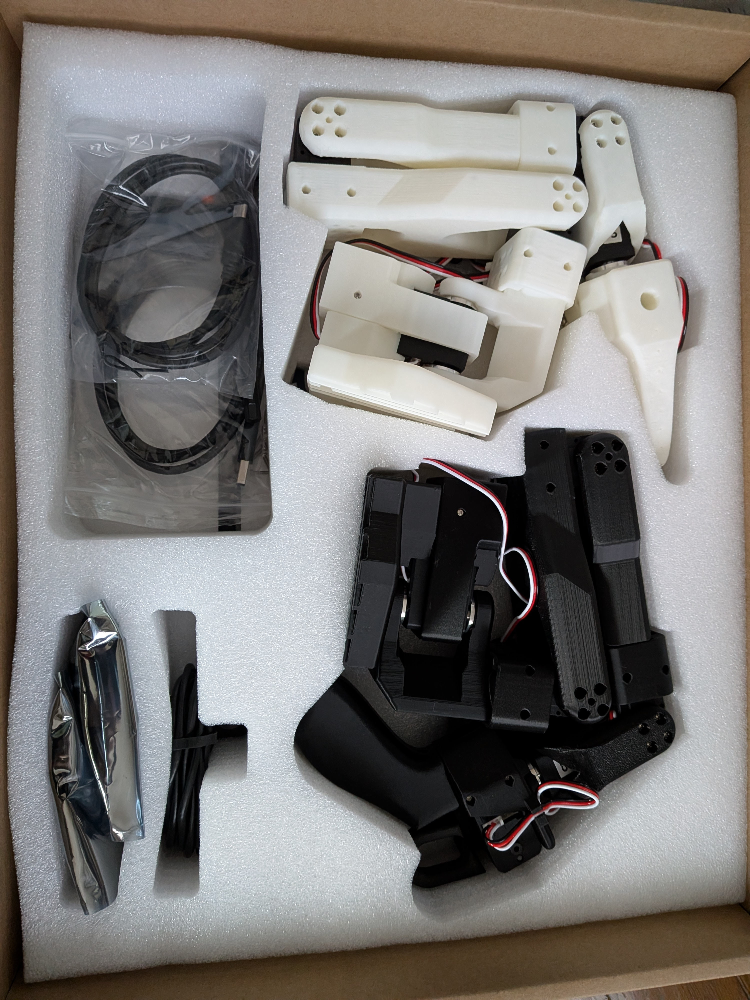
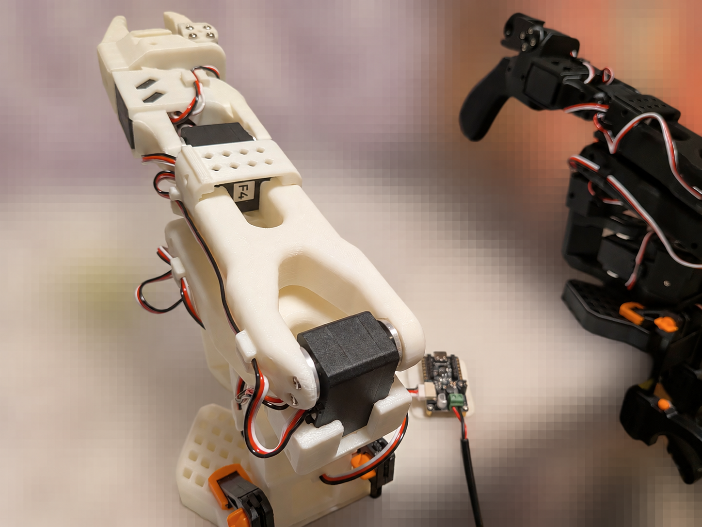

# 準備 2026/10/23-11/3

## SO-101、購入を申込

## SO-101、到着
<table>
  <tr>
    <td align="center">
      
       <b> SO-101 </b>
    </td>
  </tr>
</table>

### Hugging Face コミュニティ
     https://huggingface.co/docs/lerobot/so101

## 01-1 PC環境の準備
Ubuntu・LeRobotを準備し、USB接続とアクセス権を確認する。

### A. ロボットのUSB接続をUbuntuに渡すための usbipd-win を導入
　・WindowsのPowerShellで、以下を実行してください。 
 　　　`winget install --interactive --exact dorssel.usbipd-win`  
　・PowerShellを閉じて開き直し、次を実行してください。 
 　　　`usbipd --version`  
　・バージョン(5.3.0-54+Branch.master.Sha.aa.....)が表示されたら、usbipd-winの導入は成功です。

## 01-2 両アームの準備 
リーダーを動かすとフォロワーが追従する「テレオペレーション」の準備を行う

### A. リーダーの設定・動作確認
　・黒い基板をPCが認識  
　・アクセス権の設定も成功 ⇒ Ubuntuから黒い基板を扱える状態  
　・Ubuntu側：LeRobot用のPython環境を準備  
 　　　　　・LeRobot本体とSO-101のモーター通信に必要なソフトを入れる  
　・机にリーダーを設置する  
 　　　　　・台座をクランプで止める  
　・リーダーのキャリブレーション  
 　　　　　・UbuntuでのUSB認識とアクセス権の確認  
 　　　　　・Feetech(サーボモーターのメーカー)のSDKの通信確認機能を確認  
 　　　　　・キャリブレーション  

### B. フォロワーの設定・動作確認
　・フォロワーの3芯線を制御基板につなぐ  
　・机にフォロワーを設置する  
　　　　　・台座をクランプで止める  
　・フォロワーのキャリブレーション  
 　　　　　・UbuntuでのUSB認識とアクセス権の確認  
 　　　　　・キャリブレーション  

<table>
  <tr>
    <td align="center">
      
       <b> follower and leader </b>
    </td>
  </tr>
</table>

### 4. テレオペレーションの確認
　・黒いリーダーの制御基板を、USBでPCにつなぐ  
　・白いフォロワーの制御基板を、USBでPCにつなぐ  
　・テレオペレーションの初回確認　 
 　　　　　・[爪(指)の開閉]の追従確認：完了  
 　　　　　・[手首の曲げ伸ばし]の追従確認：完了  
 　　　　　・[手首のひねり]の追従確認：完了  
 　　　　　・[肘の曲げ伸ばし]の追従確認：完了  
 　　　　　・[肩の上げ下げ]の追従確認：完了  
　　　　　　　　　肩の追従不良発生：対応済み(原因：フォロワーのキャリブレーションのミス)  
 　　　　　・[肩の左右回転]の追従確認：完了  

## カメラの接続・映像確認

### 1. Windows用の撮影環境を作る
　・Windows用Pythonを準備 / 撮影環境を作る / Windowsでライブ映像を表示する / Ubuntuへの映像受け渡しを確認する  

### 2. カメラの仮置き・撮影位置の決定
      
 
 
 
