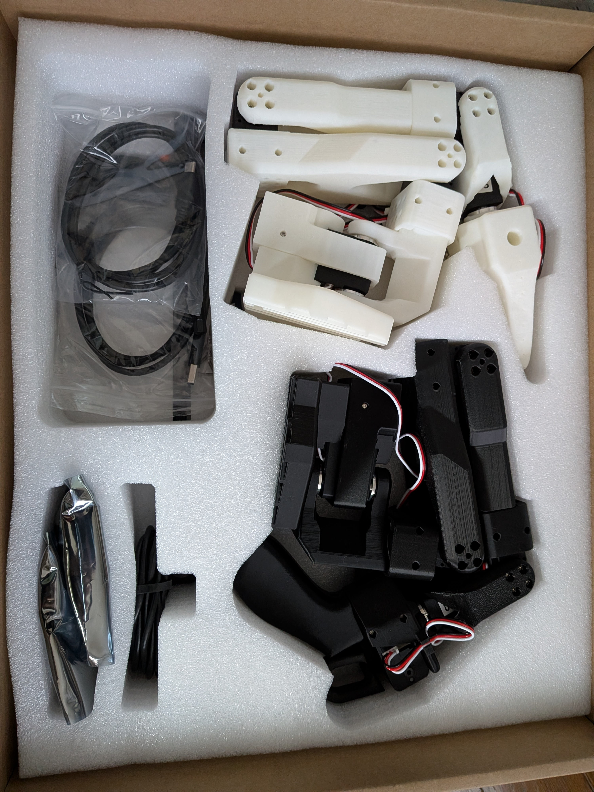

# preparation 2026/10/23-11/2

## Placed an order for the SO-ARM101

## The SO-ARM101 arrived
<table>
  <tr>
    <td align="center">
      
       <b> SO-ARM101 </b>
    </td>
  </tr>
</table>

## Hugging Face community
https://huggingface.co/docs/lerobot/so101## Preparing for "Teleoperation"
Set up "teleoperation," where a follower robot tracks the movements of a leader robot.

### 1. Install `usbipd-win` to pass the robot's USB connection to Ubuntu
・Run the following command in Windows PowerShell:  
　　　`winget install --interactive --exact dorssel.usbipd-win`  
・Close and reopen PowerShell, then run the following command:  
　　　`usbipd --version`  
・If the version (e.g., 5.3.0-54+Branch.master.Sha.aa...) is displayed, the installation of `usbipd-win` was successful. 

### 2. Leader Setup and Operational Verification
・PC detects the black control board  
・Access permissions successfully configured ⇒ The black control board is now accessible from Ubuntu  
・Ubuntu-side: Prepare the Python environment for LeRobot  
　　　・Install the software required for LeRobot and for communication with the SO-101 motors  
・Mount the leader unit onto the desk  
　　　・Secure the base using a clamp  
・Calibrate the leader unit  
　　　・Verify USB detection and access permissions in Ubuntu  
　　　・Check the communication verification function within the Feetech (servo motor manufacturer) SDK  
　　　・Perform calibration  

### 3. Follower Setup and Operational Verification
・Connect the follower’s 3-core cable to the control board  
・Mount the follower unit onto the desk  
　　　・Secure the base using a clamp  
・Calibrate the follower unit  
　　　・Verify USB detection and access permissions in Ubuntu  
　　　・Perform calibration  

### 4. Teleoperation Verification
・Connect the leader’s black control board to the PC via USB  
・Connect the control board of the white follower unit to a PC via USB  
・Initial verification of teleoperation  
・Verification of elbow flexion and extension (following motion): Completed  
