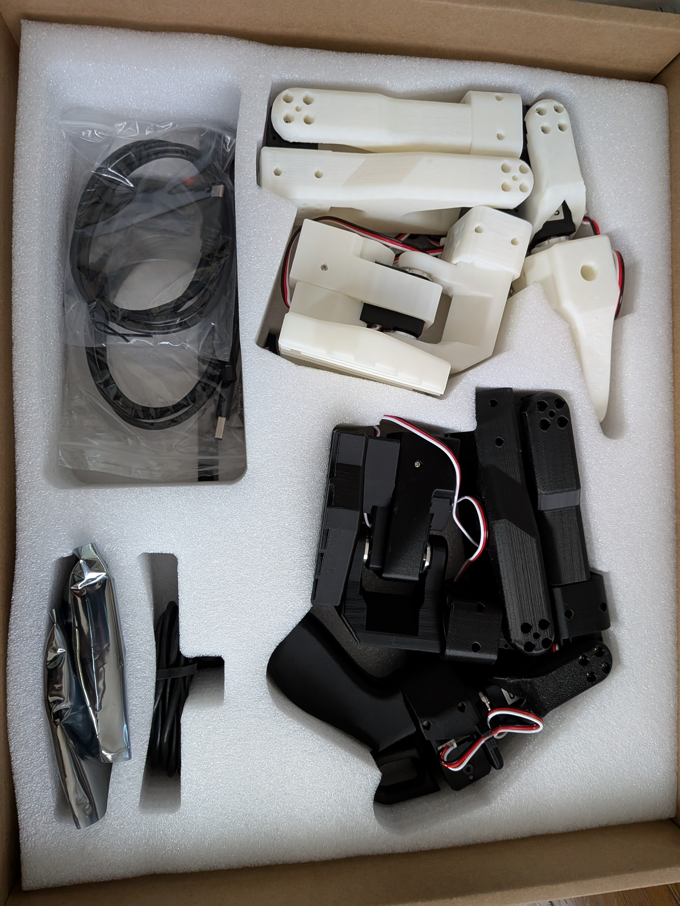

# 準備 2028/10/23-27

## 2026/10/23:SO-ARM101、購入を申込

## 2026/10/27:SO-ARM101、到着
<table>
  <tr>
    <td align="center">
      
       <b> SO-ARM101 </b>
    </td>
  </tr>
</table>

## Hugging Face コミュニティ
https://huggingface.co/docs/lerobot/so101

## 「テレオペレーション」の準備
リーダーを動かすとフォロワーが追従する「テレオペレーション」の準備を行う

### 1. ロボットのUSB接続をUbuntuに渡すための usbipd-win を導入
　・WindowsのPowerShellで、以下を実行してください。
 　　　winget install --interactive --exact dorssel.usbipd-win
