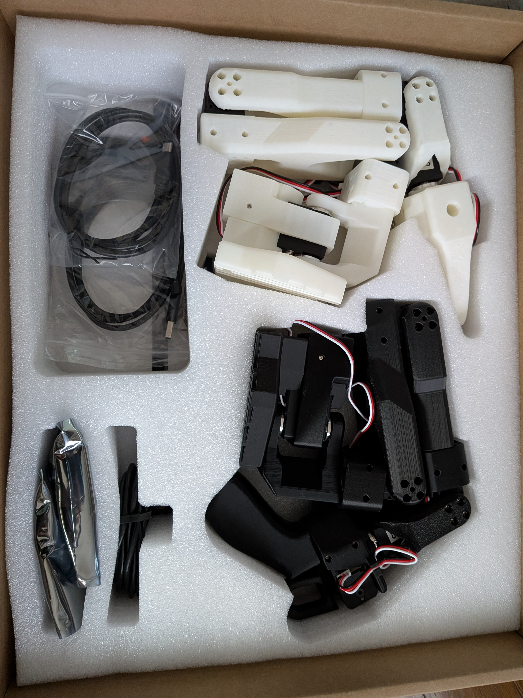

# 準備 2028/10/23-11/2

## SO-ARM101、購入を申込

## SO-ARM101、到着
<table>
  <tr>
    <td align="center">
      
       <b> SO-ARM101 </b>
    </td>
  </tr>
</table>

## Hugging Face コミュニティ
     https://huggingface.co/docs/lerobot/so101

## 「テレオペレーション」の準備
リーダーを動かすとフォロワーが追従する「テレオペレーション」の準備を行う

### 1. ロボットのUSB接続をUbuntuに渡すための usbipd-win を導入
　・WindowsのPowerShellで、以下を実行してください。 
 　　　`winget install --interactive --exact dorssel.usbipd-win`  
　・PowerShellを閉じて開き直し、次を実行してください。 
 　　　`usbipd --version`  
　・バージョン(5.3.0-54+Branch.master.Sha.aa.....)が表示されたら、usbipd-winの導入は成功です。

### 2. リーダーの設定・動作確認
　・黒い基板をPCが認識  
　・アクセス権の設定も成功 ⇒ Ubuntuから黒い基板を扱える状態  
　・Ubuntu側：LeRobot用のPython環境を準備  
 　　　　　・LeRobot本体とSO-101のモーター通信に必要なソフトを入れる  
　・机にリーダーを設置する  
 　　　　　・台座をクランプで止める  
　・リーダーのキャリブレーション  
 　　　　　・UbuntuでのUSB認識とアクセス権の確認  
 　　　　　・Feetech(サーボモーターのメーカー)のSDKの通信確認機能を確認  
 　　　　　・キャリブレーション  

### 3. フォロワーの設定・動作確認
　・フォロワーの3芯線を制御基板につなぐ  
 
 
 
