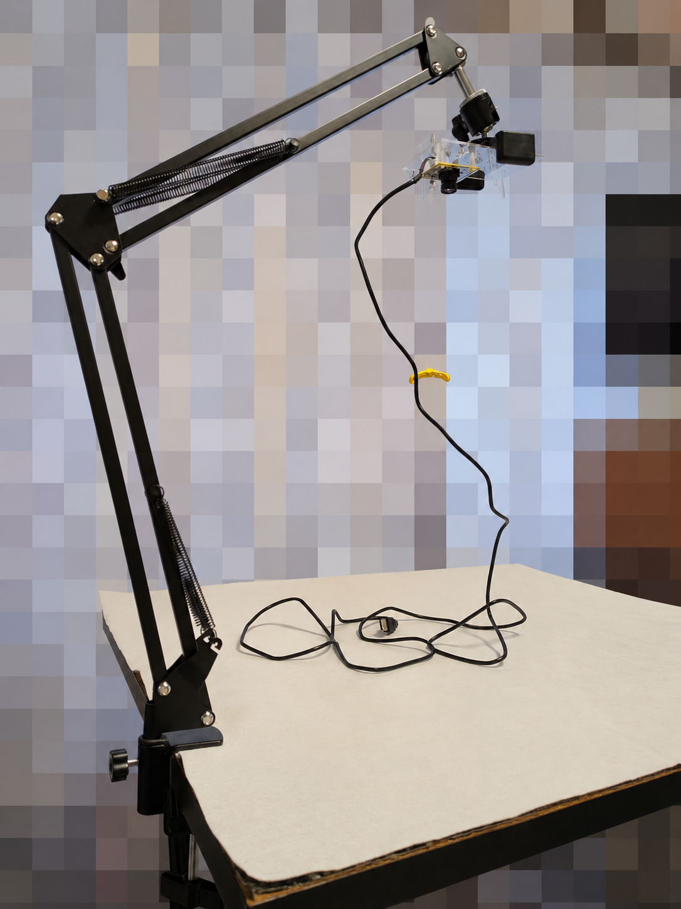
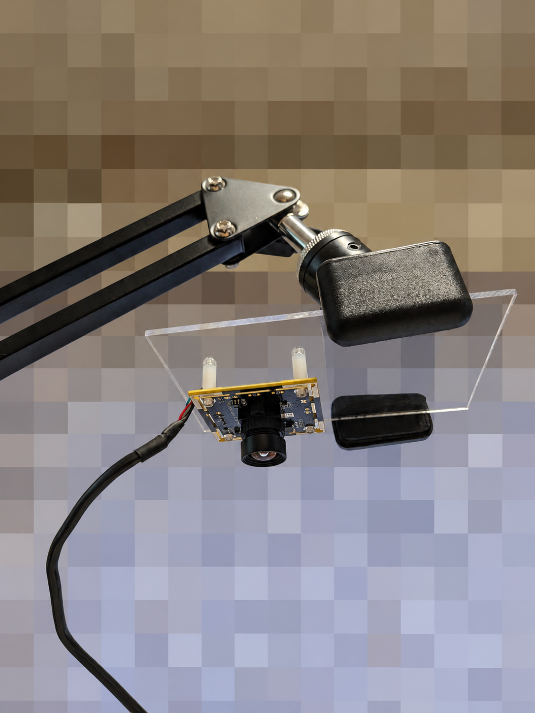
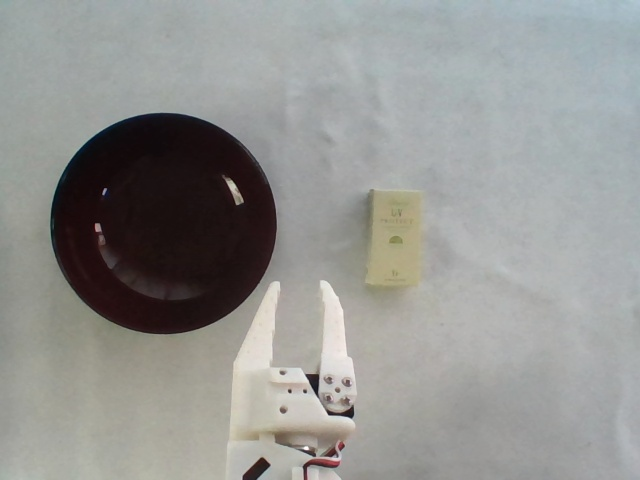

# SO-101 Demonstration data collection　　2026/11/5-11/11

## Request to purchase camera arms and camera mounting components

## Camera arm, camera mounting components, etc., have arrived.
<table>
  <tr>
    <td align="center">
      
       <b> Camera arm, camera mounting components, etc </b>
    </td>
  </tr>
</table>

## Camera arm assembly
<table>
  <tr>
    <td align="center">
      
       <b> Overall view after assembly </b>
    </td>
    <td align="center">
      
       <b> Camera section after assembly </b>
    </td>
  </tr>
</table>

## 02-1. Connect the camera and check the video
Connect the supplied USB camera and view its feed in Ubuntu. Mount it so the white follower’s gripper and the target object are both visible in the frame.

### A. Setting up a recording/capture environment for Windows
　・Setting up Python for Windows / Preparing the filming environment / Displaying live video on Windows / Verifying video transmission to Ubuntu  

### B. Temporarily placing the camera and determining the shooting position
　・Position the white grippers so that they and the objects being handled (the workpiece and its container) are both visible within the same field of view.
<table>
  <tr>
    <td align="center">
      
       <b> Image from the camera </b>
    </td>
  </tr>
</table>
      
