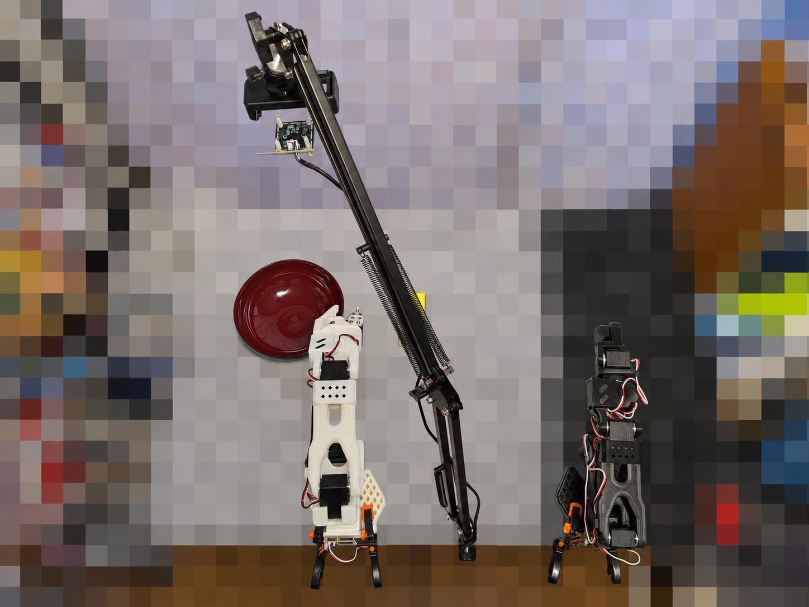

# SO-101実演データの収集　　2026/11/5-11/11

## カメラアーム、カメラ設置パーツ、購入を申込

## カメラアーム、カメラ設置パーツ等、到着
<table>
  <tr>
    <td align="center">
      
       <b> カメラアーム、カメラ設置パーツ等 </b>
    </td>
  </tr>
</table>

## カメラアーム、組み立て
<table>
  <tr>
    <td align="center">
      
       <b> 組み立て後、全体 </b>
    </td>
    <td align="center">
      
       <b> 組み立て後、カメラ部 </b>
    </td>
  </tr>
</table>

## 作業環境、完成
<table>
  <tr>
    <td align="center">
      
       <b> 作業環境 </b>
    </td>
  </tr>
</table>

## 02-1. カメラの接続・映像確認 
付属USBカメラを接続。Ubuntuで白い爪と作業対象が同じ画面に映る位置に固定する。

### A. Windows用の撮影環境を作る
　・Windows用Pythonを準備 / 撮影環境を作る / Windowsでライブ映像を表示する / Ubuntuへの映像受け渡しを確認する  

### B. カメラの仮置き・撮影位置の決定
　・白い爪と作業対象(ワークと入れ物)が同じ画面に映る位置に固定する。

<table>
  <tr>
    <td align="center">
      
       <b> カメラからの画像 </b>
    </td>
  </tr>
</table>
      
## 02-2. 作業を決めて試し撮り 
例：ブロックをA地点からB地点へ移す。1回記録し、映像・関節位置・操作指令を確認する。

### A. 作業内容
　・黒いリーダーで白いフォロワーを操作し、黄緑のワークをつかみ、持ち上げて赤い入れ物へ移し、爪を開いて置く。  

### B. 動作確認・調整
　- 記録前にリーダーとフォロワーの姿勢を近づけ、追従を確認した。  
　- 肩・肘の上方向への追従が止まる症状に対し、現在位置から目標位置までの差の制限を調整した。  
　- 肩の上下・肘は4度、その他の関節は設定値3で試行し、ワークを入れ物へ置くまでの動作を確認した。  
　- 制御・記録の設定は30fpsとした。  
　- 終了時の脱力による落下を防ぐため、プログラム終了後もフォロワーの保持トルクを残す設定を使用した。 
 　　電源を切る際は、アームを支えてから切る。  

### C. 試し撮りの結果
　・試行 `retry04` で、黄色いワークを赤い入れ物へ置く作業に成功した。記録処理と動画のエンコードはエラーなく終了した。  

| 項目 | 記録内容 |
| --- | --- |
| データセット名 | `so101_yellow_pick_place_retry04_20261112_154246` |
| エピソード数 | 1 |
| 記録時間の設定 | 60秒 |
| 保存フレーム数 | 1,789 |
| データセットの設定fps | 30 |
| 映像 | 640 × 480、AV1形式のMP4 |
| 関節位置 | `observation.state`：6関節 |
| 操作指令 | `action`：6関節 |
| 数値データ | Parquet形式 |
| 収集時の保存先 | ローカルPC（自動アップロードなし） |

カメラはWindowsで撮影し、共有フォルダーの画像をUbuntu側で読み取る方式を使用した。事前確認での画像更新は約8.1枚／秒だったため、30fpsの保存映像には同じ画像が繰り返し含まれる。

### D. 保存ファイル

- 数値データ：`data/chunk-000/file-000.parquet`
- 動画：`videos/observation.images.workspace/chunk-000/file-000.mp4` --->  [動画](video/so101_retry04.mp4)
- メタデータ：`meta/info.json`

### E. 検証結果と今後の改善

　・関節位置・操作指令は各1,789行×6関節で、NaN・無限大がないことを確認した。動画は全1,789フレームを読み取れ、数値データとフレーム数が一致した。 
 　　目視でも黒い帯・画像の欠け・長い映像停止は見られなかった。 
　・把持の瞬間はフォロワー自身に隠れるため、爪とワークの接触状態を映像で直接確認できない。 
 　　今回は試し撮りの成果物として保存し、今後の学習用実演の収集に向けて、把持が見えるようカメラ位置を調整する。 

 
 
 
