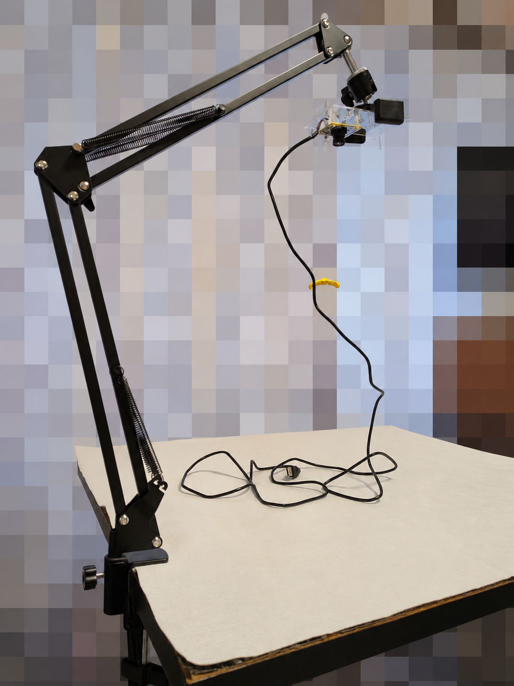
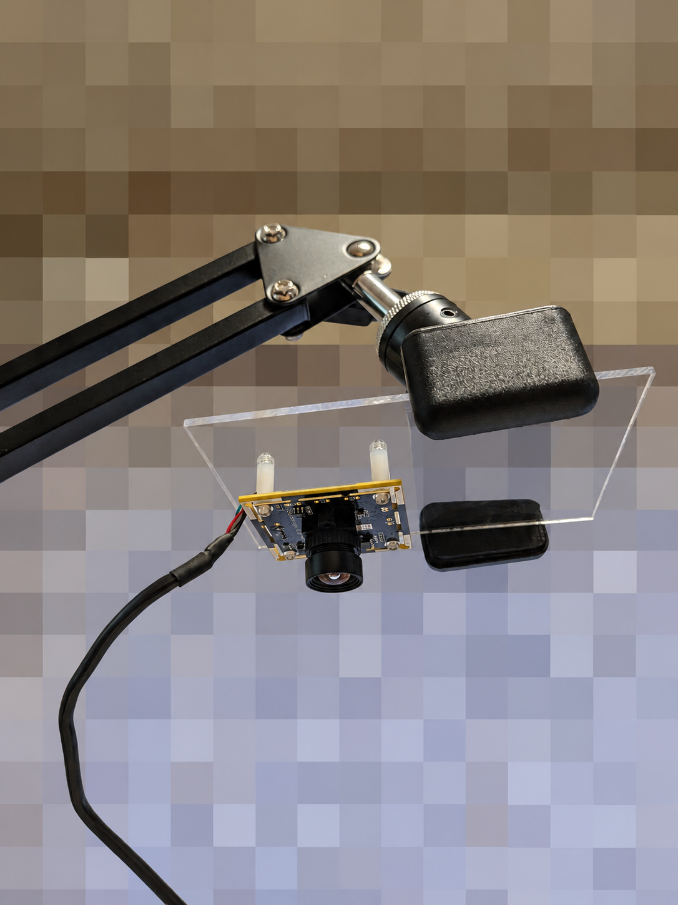
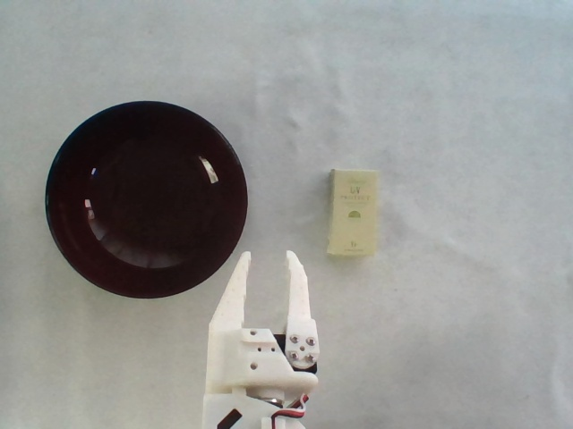

# SO-101実演データの収集　　2026/11/5-11/10

## カメラアーム、カメラ設置パーツ、購入を申込

## カメラアーム、カメラ設置パーツ等、到着
<table>
  <tr>
    <td align="center">
      
       <b> カメラアーム、カメラ設置パーツ等 </b>
    </td>
  </tr>
</table>

## カメラアーム、組み立て
<table>
  <tr>
    <td align="center">
      
       <b> 組み立て後、全体 </b>
    </td>
    <td align="center">
      
       <b> 組み立て後、カメラ部 </b>
    </td>
  </tr>
</table>

## 02-1. カメラの接続・映像確認 
付属USBカメラを接続。Ubuntuで白い爪と作業対象が同じ画面に映る位置に固定する。

### A. Windows用の撮影環境を作る
　・Windows用Pythonを準備 / 撮影環境を作る / Windowsでライブ映像を表示する / Ubuntuへの映像受け渡しを確認する  

### B. カメラの仮置き・撮影位置の決定
　・白い爪と作業対象(ワークと入れ物)が同じ画面に映る位置に固定する。

<table>
  <tr>
    <td align="center">
      
       <b> カメラからの画像 </b>
    </td>
  </tr>
</table>
      
 
 
 
