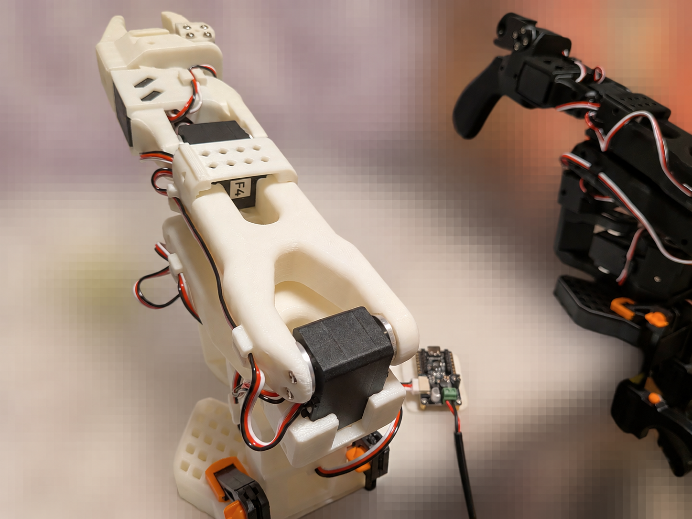
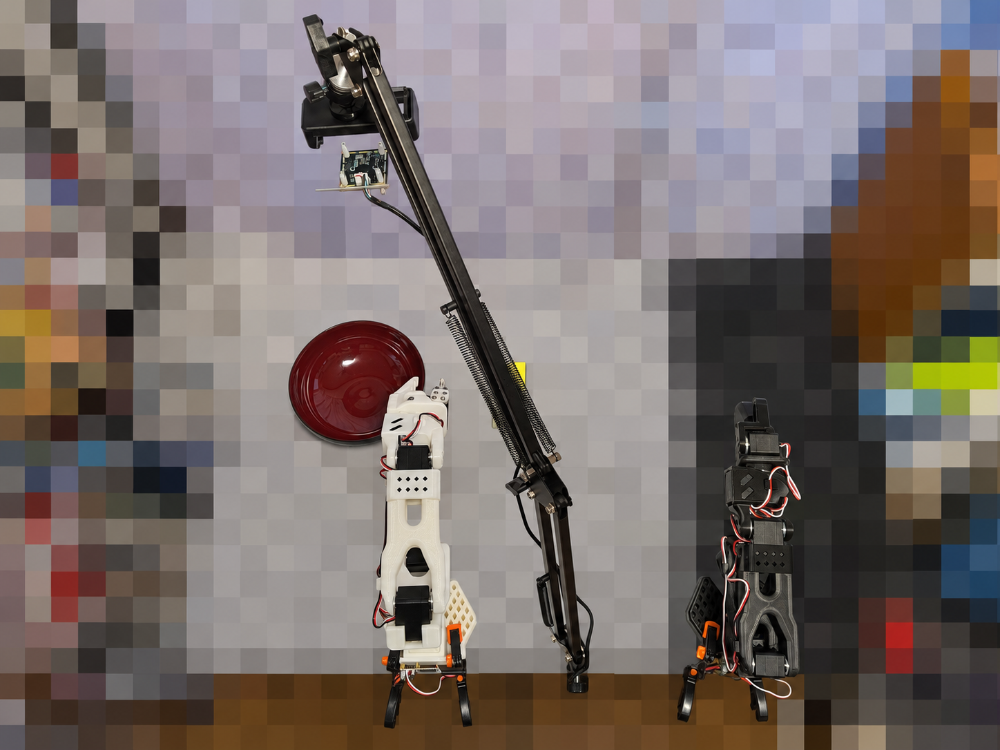

# Pysical_AI_Real-to-Sim_and_Sim-to-Real

Control models, learned and verified through simulation, are translated into actions performed by an actual robot.

## Introduction
・I have previously implemented VLA (Vision-Language-Action) in simulations using Isaac Lab, and I now intend to deploy it on a physical robot. 
　I am currently developing a concept for Real-to-Sim and Sim-to-Real pipeline. 
・I have mapped out the concept into a schedule. Please review the schedule below.  

・Based on the schedule, we proceeded with the purchase of a robot arm and a camera arm—including the assembly of the latter—and established a teleoperation environment. 
・First of all, I decided to proceed with Pick and Place.  
・We teleoperated the SO-101 to collect actual machine data, created a model using imitation learning, and evaluated it on the actual machine.  

## Schedule

- **[English — ROADMAP_ENG.md](ROADMAP_ENG.md)**

## Actual Tasks

① [SO-101 hardware setup](01_SO-101_hardware_setup/README_ENG.md)  

<table>
  <tr>
    <td align="center">
      
       <b> follower and leader </b>
    </td>
  </tr>
</table>

② [Demonstration data collection](02_Demonstration_data_collection/README_ENG.md)   

<table>
  <tr>
    <td align="center">
      
       <b> work environment </b>
    </td>
  </tr>
</table>

　　Performed teleoperation ( [video of the process: teleoperation.mp4](02_Demonstration_data_collection/video/) ) 
　　and saved data from 20 successful trials 
　　　　⇒　[Collected video data](02_Demonstration_data_collection/datasets/video/)

③ [Imitation learning and hardware evaluation](03_Imitation_learning_and_hardware_evaluation/README_ENG.md)   

　　We provided the model with video of the current operating environment and evaluated its performance on the actual hardware.  
　　　　⇒　[Video of successful evaluation](03_Imitation_learning_and_hardware_evaluation/video_evaluation/)

