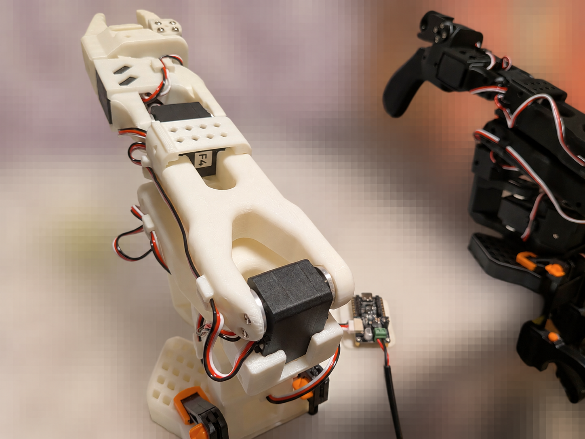
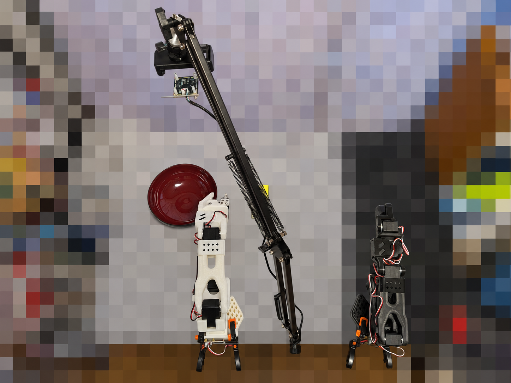

# Pysical_AI_Real-to-Sim_and_Sim-to-Real

シミュレーションを通じて学習・検証された制御モデルから、実際のロボットで行動にする。

## イントラダクション

・これまで、issac-labにてシミュレーションでVLAを実現してきましたが、実際のロボットで行動させたいと考えています。 
　今、Real-to-Sim / Sim-to-Realパイプラインの構想を練っています。 
・構想をスケジュール化しました。下記スケジュールを確認してください。 

・スケジュールを元に、ロボットアーム(SO-101)購入、カメラアーム購入＆組み立てを進め、テレオペレーション環境を構築しました。 
・まずは、Pick and Placeで進めることにしました。 
・SO-101をテレオペレーションして実機データを収集し、模倣学習でモデル作成し、実機で評価しました。 

## スケジュール

- **[Japanese — ROADMAP_JPN.md](ROADMAP_JPN.md)**

## 実タスク

① [SO-101実機セットアップ](01_SO-101_hardware_setup/README_JPN.md)  

<table>
  <tr>
    <td align="center">
      
       <b> follower and leader </b>
    </td>
  </tr>
</table>

② [実演データの収集](02_Demonstration_data_collection/README_JPN.md)   

<table>
  <tr>
    <td align="center">
      
       <b> 作業環境 </b>
    </td>
  </tr>
</table>

③ [模倣学習と実機評価](03_Imitation_learning_and_hardware_evaluation/README_JPN.md)   

      黄緑のワークを把持し、赤い入れ物へ置く動作に成功
      　⇒（[評価の成功動画](03_Imitation_learning_and_hardware_evaluation/video_evaluation/) )

 
